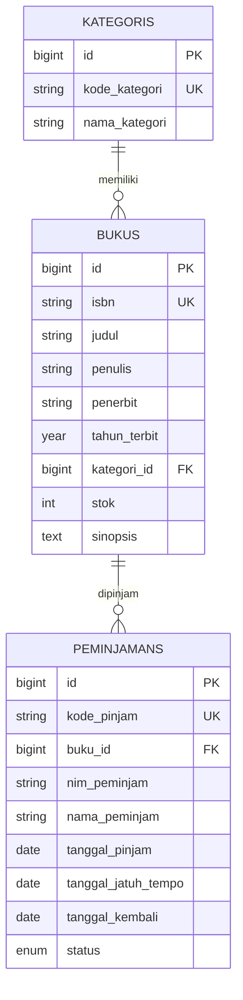

# SIPUS-Del Tahap 2 — Sistem Informasi Perpustakaan Kampus Del

Tugas Mandiri Minggu 6 — Pemrograman & Pengujian Web (12S3101), Institut Teknologi Del

**Nama:** Olivia Tambunan | **NIM:** 12S24048

## Deskripsi

Lanjutan SIPUS-Del Minggu 5 (CRUD Buku dan Kategori dengan pola MVC). Pada tahap ini ditambahkan sirkulasi peminjaman dan pengembalian buku yang aman terhadap race condition, statistik perpustakaan, serta login pustakawan. Dibangun dengan Laravel 13, PHP 8.3, dan MySQL (Laragon).

## Fitur

- **Tabel `peminjamans` & relasi Eloquent:** foreign key `buku_id` dengan `cascadeOnDelete`, relasi `Peminjaman belongsTo Buku` dan `Buku hasMany Peminjaman`
- **Transaksi ACID:** peminjaman dan pengembalian memakai `DB::transaction()` dan `lockForUpdate()`; stok 0 ditolak dan di-rollback; NIM yang sama tidak bisa meminjam buku yang sama sebelum mengembalikannya; `QueryException` dicatat ke `Log::error()`
- **Query Builder & filter:** kartu statistik dengan `DB::table()`, `withCount('peminjamans')`, pencarian dinamis `when()`, dan paginasi `withQueryString()`
- **Session & autentikasi:** login/logout dengan `Auth::attempt()`, `session()->regenerate()`, `invalidate()` + `regenerateToken()`, rute mutasi diproteksi middleware `auth`, state sesi, dan cookie `Cookie::queue()`
- **Seeder:** akun pustakawan, sampel buku stok 0 dan stok 1, serta sampel transaksi peminjaman

## Instalasi

```bash
git clone https://github.com/OliviaTambunan1/ppw-2026-week5-12S24048.git
cd ppw-2026-week5-12S24048
git checkout week6-db-session
composer install
cp .env.example .env             # Windows PowerShell: copy .env.example .env
php artisan key:generate
# Buat database kosong bernama sipus_del di MySQL (Laragon: Start All)
php artisan migrate:fresh --seed
php artisan serve
```

## Akun Uji Pustakawan

| Email | Password |
|---|---|
| pustakawan@del.ac.id | password123 |

Seeder juga membuat 5 kategori, 22 buku (termasuk sampel stok 0 dan stok 1), dan 3 sampel transaksi peminjaman.

## ERD



## Bukti Pengujian

Seluruh screenshot bukti pengujian tersimpan di folder [`docs/img/`](docs/img/):

| Berkas | Isi bukti |
|---|---|
| [`pinjam-kembali.png`](docs/img/pinjam-kembali.png) | Peminjaman dan pengembalian buku, stok berubah atomik |
| [`stok-nol-ditolak.png`](docs/img/stok-nol-ditolak.png) | Penolakan peminjaman saat stok = 0, transaksi di-rollback |
| [`cookie-httponly.png`](docs/img/cookie-httponly.png) | Audit cookie di DevTools: HttpOnly dan SameSite=Lax |